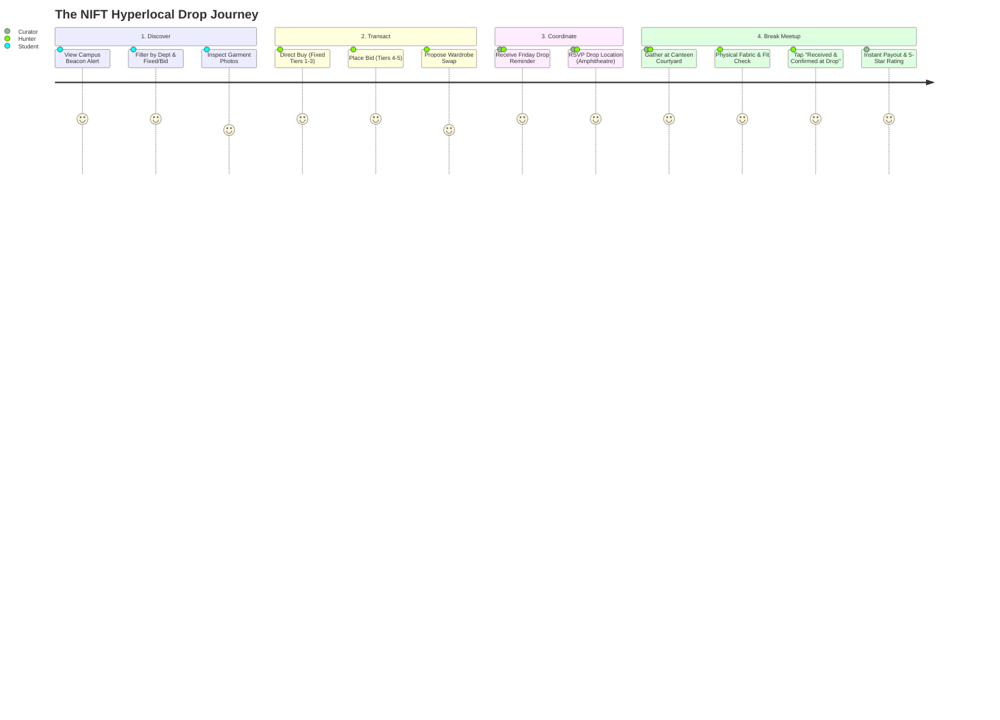

# Phase 2: Empathy & Behavioral Modeling — NIFT Hyderabad Campus

**Platform Identity:** NIFT Hyderabad Thrift Closet  
**Curatorial Direction:** Campus Circular Fashion × Youth Culture × Peer-to-Peer Barter  
**Campus Scope:** Exclusively National Institute of Fashion Technology (NIFT), Hyderabad  
**Creative Director & Product Lead:** Simran Singh (BD/24/164, Fashion Communication, NIFT Hyderabad)  
**Technical Architect & UX Mentor:** Antigravity AI  

---

## 1. The Fluid Dual-Persona in a Campus Design Atelier

At NIFT Hyderabad, buyers and sellers are not separate market demographics. They are peer design students across departments—**Fashion Communication (FC), Fashion Design (FD), Textile Design (TD), Accessory Design (AD), and Knitwear Design (KD)**. 

The platform operates on **Persona Fluidity**: A student acts as an *Archive Hunter* on Thursday to find styling pieces for a Friday photo shoot, and becomes a *Wardrobe Curator* on Monday to circulate studio garments or declutter their hostel wardrobe.

```
                  THE NIFT HYDERABAD STUDENT
                              ▲
                              │
               ┌──────────────┴──────────────┐
               │                             │
    THE WARDROBE CURATOR           THE ARCHIVE HUNTER
        (Seller Mode)                 (Buyer Mode)
 • Decluttering semester projects • Sourcing styling shoot pieces
 • Funding new fabric/materials   • Finding rare vintage/archive gems
 • Relieved by Fixed Pricing      • Excited by Live Upcycling Bids
 • Values zero packaging waste    • Values in-person fit check at drop
```

### Persona Profile: The NIFT Wardrobe Curator (Seller Mode)
- **Profile:** 2nd/3rd year design student accumulating garments from seasonal styling courses, personal collections, or unworn trend items.
- **Motivations:**
  - Circulating garments to fellow design peers who appreciate textile quality and silhouette.
  - Earning funds for semester jury supplies, fabrics, or new wardrobe pieces.
- **Pain Points:** 
  - Dealing with lowball messages and endless negotiation on Instagram stories.
  - Packaging items and coordinating courier shipping while balancing intense studio deadlines.
- **UX Reassurance:** 
  - **Fixed Pricing for Tiers 1–3:** Guaranteed curatorial value protection. No lowballs.
  - **Zero-Packaging Break Drops:** Simply bringing the garment to the Canteen Amphitheatre during lunch break.

### Persona Profile: The NIFT Archive Hunter (Buyer Mode)
- **Profile:** Design student hunting for unique silhouettes, vintage denim, ethnic handlooms, or experimental styling layers on a student budget.
- **Motivations:**
  - Finding distinctive statement pieces that stand out from generic fast-fashion mall retail.
  - Sourcing distressed or well-worn pieces at low starting bids for experimental DIY upcycling.
- **Pain Points:** 
  - Vanity sizing anxiety ("Will this vintage jacket fit my shoulder width?").
  - Hidden stains or tears concealed by Instagram aesthetic filters.
- **UX Reassurance:** 
  - Standardized flat-lay measurements (chest, waist, inseam).
  - Physical inspection in daylight at the campus drop event before tapping **"Received & Confirmed"**.

---

## 2. Second-Hand Campus Empathy Map

```
┌───────────────────────────────────────┬───────────────────────────────────────┐
│              THINK & FEEL             │                 HEAR                  │
├───────────────────────────────────────┼───────────────────────────────────────┤
│ BUYER (STUDENT):                      │ • "Did you see that vintage leather   │
│ • "Will this fit my proportions for   │   vest dropped on the app?"           │
│   tomorrow's editorial shoot?"        │ • "Don't sell on Insta DMs, everyone  │
│ • "Can I win this distressed denim on │   ghosts after asking for pics."      │
│   campus bidding for under ₹800?"     │ • "Meet me at the Canteen lawn        │
│ • Relief of touching the fabric       │   during lunch break to swap."        │
│   before finalizing payment.          │                                       │
│                                       │                                       │
│ SELLER (STUDENT):                     │                                       │
│ • "I spent hours tailoring this; I    │                                       │
│   won't let anyone lowball me."       │                                       │
│ • "I don't have time to mail parcels  │                                       │
│   during assignment submission week." │                                       │
├───────────────────────────────────────┼───────────────────────────────────────┤
│               SAY & DO                │                 SEE                   │
├───────────────────────────────────────┼───────────────────────────────────────┤
│ SAY:                                  │ • Cluttered WhatsApp batch groups     │
│ • "Are you coming to the Friday drop  │   filled with messy resale photos.    │
│   at the Canteen Amphitheatre?"       │ • Fellow students re-wearing fast     │
│ • "Let's trade my jacket for your     │   fashion because finding thrifted    │
│   boots + ₹300."                      │   pieces locally is too hard.         │
│ • "What is the flat-lay bust spec?"   │ • Discarded muslin and wearable       │
│                                       │   sample garments in studio bins.     │
│ DO:                                   │                                       │
│ • Bids on distressed pieces in breaks.│                                       │
│ • RSVPs to the Campus Drop Beacon.    │                                       │
│ • Brings garments to the Courtyard.   │                                       │
└───────────────────────────────────────┴───────────────────────────────────────┘
```

---

## 3. The Campus Drop User Journey Map



### Stage-by-Stage Breakdown
1. **Discover:** The student opens the app and sees the **Campus Drop Beacon** (*"Friday Lunch Break Drop @ Canteen Amphitheatre"*). Browses 2-column feed filtered by department (e.g. FC, FD, TD).
2. **Evaluate & Transact:**
   - For pristine pieces (Tiers 1–3): One-tap **Fixed Price Buy** locks the piece immediately.
   - For distressed/upcycling pieces (Tiers 4–5): Student places a **Live Bid** (+₹50, +₹100) and watches the auction close before the drop.
   - For trades: Proposes a bilateral swap using pieces from their own closet.
3. **The Break Drop (The Physical Social Ritual):**
   - At 1:30 PM on Friday, buyers and sellers gather at the **Canteen Amphitheatre steps**.
   - The buyer checks flat-lay measurements, fabric hand-feel, and disclosed flaws in natural sunlight.
   - Zero courier delays, zero packaging trash.
4. **Closing Milestone:**
   - Buyer taps **`[Received & Confirmed at Drop]`**.
   - Instant escrow release, reputation update, and circular celebration.
