# Phase 3: Information Architecture & Taxonomy — NIFT Hyderabad Campus

**Platform Identity:** NIFT Hyderabad Thrift Closet  
**Curatorial Direction:** Hyperlocal Campus Marketplace × Youth Culture × Peer-to-Peer Barter  
**Campus Scope:** Exclusively National Institute of Fashion Technology (NIFT), Hyderabad  
**Creative Director & Product Lead:** Simran Singh (BD/24/164, Fashion Communication, NIFT Hyderabad)  
**Technical Architect & UX Mentor:** Antigravity AI  

---

## 1. Global Sitemap & Navigation Schema

```mermaid
graph TD
    AppRoot[NIFT Thrift Closet Root] --> Beacon[Campus Drop Event Beacon]
    AppRoot --> NavDiscover[1. Discover]
    AppRoot --> NavSearch[2. Search]
    AppRoot --> NavSell[3. Sell / +]
    AppRoot --> NavActivity[4. Activity]
    AppRoot --> NavCloset[5. My Closet]

    Beacon --> DropRSVP[RSVP for Friday Lunch Break Drop]
    Beacon --> DropZoneMap[Canteen Amphitheatre & Lawn Steps]

    NavDiscover --> DiscoverFeed[Campus Editorial Feed]
    NavDiscover --> ParadigmFilters[Fixed Price vs. Live Bids Filters]
    NavDiscover --> DeptPills[FC, FD, TD, AD Department Drops]

    NavSearch --> SearchBar[Keyword Search: Brands, Tags, Garments]
    NavSearch --> ParadigmToggle[Fixed Tiers 1-3 vs. Bidding Tiers 4-5]
    NavSearch --> DeptDropdown[NIFT Departments: FC, FD, TD, AD, KD]
    NavSearch --> ContextFilters[Contextual Waist/Inseam Inputs]

    NavSell --> SellWizard[6-Step Guided Wizard]
    SellWizard --> StepCondition[Select 5-Tier Condition]
    StepCondition -->|Tiers 1-3| FixedPriceSetup[Set Direct Fixed Price]
    StepCondition -->|Tiers 4-5| BiddingSetup[Set Starting Bid & Auction Duration]
    SellWizard --> DropZonePicker[Select Campus Drop Zones]

    NavActivity --> TabBids[Live Campus Bids]
    NavActivity --> TabSwaps[Wardrobe Swap Proposals]
    NavActivity --> TabDrops[Scheduled Break Drop Handoffs]

    NavCloset --> ViewCloset[Mode A: My Closet - Active Listings & Swaps]
    NavCloset --> ViewSaved[Mode B: My Saved - Wishlist Archive]
```



---

## 2. Departmental & Garment Taxonomy

### A. NIFT Hyderabad Departmental Tagging
Every listing and seller profile carries a verified campus department tag:
- **FC** — Fashion Communication (Styling, lookbooks, archive fashion)
- **FD** — Fashion Design (Structured tailoring, silhouettes, pattern drafts)
- **TD** — Textile Design (Handloom, prints, surface ornamentation, natural dyes)
- **AD** — Accessory Design (Bags, footwear, jewelry, hardware)
- **KD** — Knitwear Design (Knit tops, cardigans, winterwear, crochet)
- **DFT** — Design & Fashion Technology (Functional streetwear, technical wear)

---

### B. The 9 Primary Garment Categories
1. **Tops** (Tees, shirts, blouses, knitwear, corsets)
2. **Bottoms** (Denim, trousers, cargo pants, skirts, shorts)
3. **Dresses** (Mini, midi, maxi, slip dresses)
4. **Outerwear** (Jackets, blazers, coats, hoodies, windbreakers)
5. **Indian / Ethnic Wear** (Kurtas, sarees, dupattas, ethnic sets)
6. **Sets / Co-ords** (Matched two-pieces, suit sets)
7. **Footwear** (Boots, loafers, sneakers, sandals)
8. **Bags** (Totes, shoulder bags, backpacks, micro bags)
9. **Accessories** (Jewelry, belts, sunglasses, scarves)

---

### C. Commercial Pricing Paradigms (Two-Track Architecture)

| Commercial Paradigm | Eligible Condition Tiers | User Interaction Flow |
| :--- | :--- | :--- |
| **Track A: Direct Fixed Price** | **1. New / Unworn**<br>**2. Like New**<br>**3. Gently Used** | • Buyer sees firm price.<br>• One-tap **`[Buy for ₹X (Fixed)]`** reserves item for drop.<br>• No lowballing or counter-offers allowed.<br>• Optional **`[⇄ Propose Swap]`** if enabled. |
| **Track B: Campus Live Bidding** | **4. Well Used**<br>**5. Visible Wear / Flaws** | • Seller sets base Starting Bid.<br>• Students tap **`[🔥 Place Bid]`** with quick increments (+₹50, +₹100).<br>• Real-time high bidder updates.<br>• Closes prior to Friday campus drop. |

---

## 3. Physical Fulfillment Architecture (Zero Courier Delivery)

Traditional shipping is completely eliminated to foster campus culture and remove packaging waste:

```
CAMPUS DROP EVENT ARCHITECTURE
 ├── 1. CANTEEN AMPHITHEATRE & LAWN STEPS (Primary Campus Drop Zone)
 │    ├── Peak activity: Friday Lunch Break (1:15 PM – 2:00 PM)
 │    └── High-visibility social gathering for inspection and exchanges
 ├── 2. TEXTILE DEPARTMENT LAWN & CORRIDORS
 │    ├── Informal outdoor lawn between studios
 │    └── Ideal for quiet studio break trades and fabric evaluations
 └── 3. RESOURCE CENTRE / LIBRARY LOBBY
      ├── Indoor, well-lit air-conditioned foyer
      └── Recommended for high-value footwear and outerwear inspection
```

---

## 4. Product Detail Page (PDP): Paradigm-Aware 7-Layer Blueprint

```
┌────────────────────────────────────────────────────────┐
│ [← Back]          NIFT HYDERABAD PDP          [Share]  │
├────────────────────────────────────────────────────────┤
│ 1. HERO IMAGE GALLERY (Front / Back / Tag / Flaw)      │
├────────────────────────────────────────────────────────┤
│ 2. ITEM IDENTITY & PARADIGM CALLOUT                    │
│    Brand: Carhartt • Dept: Fashion Comm (FC)           │
│    Title: Boxy Cropped Canvas Work Jacket              │
│    [ 🔒 FIXED PRICE ] or [ 🔥 CAMPUS LIVE BIDDING ]    │
│    Price / High Bid: ₹2,400                            │
│    Condition: [ GENTLY USED • TIER 3 ]                 │
├────────────────────────────────────────────────────────┤
│ 3. DYNAMIC FLAT-LAY MEASUREMENTS                       │
│    Tag Size: L (Fits Boxy M)                           │
│    • Chest (Pit-to-Pit): 22.5 in  • Shoulder: 19.0 in  │
│    • Center Back Length: 24.0 in  • Sleeve: 23.5 in    │
├────────────────────────────────────────────────────────┤
│ 4. CONDITION & MANDATORY FLAW TRANSPARENCY             │
│    Declared Flaws: Minor inner cuff wear; no stains.   │
├────────────────────────────────────────────────────────┤
│ 5. CURATORIAL ATTRIBUTES & SWAP WISHLIST               │
│    Tags: #Streetwear #Archive #Workwear                │
│    Curator Swap Note: "Open to swap for chunky boots"  │
├────────────────────────────────────────────────────────┤
│ 6. SELLER DEPARTMENT CARD                              │
│    Ria Sharma (@ria_fc) ★ 4.9 (28 drops) • NIFT FC '26 │
├────────────────────────────────────────────────────────┤
│ 7. SCHEDULED CAMPUS DROP LOCATION                      │
│    📍 Friday Lunch Break @ Canteen Amphitheatre        │
├────────────────────────────────────────────────────────┤
│ STICKY FOOTER ACTIONS:                                 │
│ [⇄ Propose Swap]   │   [Buy for ₹2,400 (Fixed)]        │
│          -- OR (if Tier 4/5 Bidding) --                │
│ [⇄ Propose Swap]   │   [🔥 Place Bid (Min ₹1,150)]     │
└────────────────────────────────────────────────────────┘
```
