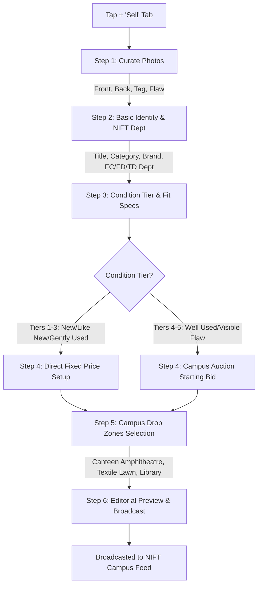
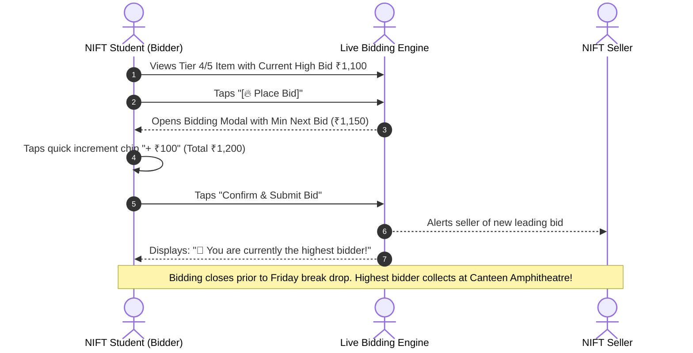

# Phase 4: User Flows & Low-Fidelity Wireframes — NIFT Hyderabad Campus

**Platform Identity:** NIFT Hyderabad Thrift Closet  
**Curatorial Direction:** Hyperlocal Campus Marketplace × Youth Culture × Peer-to-Peer Barter  
**Campus Scope:** Exclusively National Institute of Fashion Technology (NIFT), Hyderabad  
**Creative Director & Product Lead:** Simran Singh (BD/24/164, Fashion Communication, NIFT Hyderabad)  
**Technical Architect & UX Mentor:** Antigravity AI  

---

## 1. Core Task Flows & Decision Logic

### Flow A: The 6-Step Guided Listing Wizard (with Paradigm Fork)


---

### Flow B: Campus Live Bidding Flow (Tiers 4 & 5)


---

### Flow C: Campus Break Drop Handoff Flow (Zero Courier)

```mermaid
stateDiagram-v2
    [*] --> BeaconTriggered: App broadcasts: "Friday Lunch Break Drop @ 1:30 PM"
    BeaconTriggered --> RSVPConfirmed: Student RSVPs to attend Canteen Amphitheatre Drop
    RSVPConfirmed --> BreakGathering: Students meet face-to-face at Amphitheatre steps
    BreakGathering --> SunlightInspection: Buyer checks flat-lay fit, fabric feel & flaws in daylight
    SunlightInspection --> ReceivedAndConfirmed: Buyer taps "[✓ Received & Confirmed at Drop]"
    SunlightInspection --> DropCancelled: Discrepancy found; item returned to peer with zero penalty
    ReceivedAndConfirmed --> PayoutAndRating: Payout released & 5-Star reputation updated
    DropCancelled --> [*]
    PayoutAndRating --> [*]
```


---

## 2. Low-Fidelity Structural Wireframes

### Wireframe 1: Discover Feed with Campus Drop Beacon
```
┌────────────────────────────────────────────────────────┐
│ NIFT HYDERABAD • CAMPUS ARCHIVE            [🔊 Drop] [🔍]│
├────────────────────────────────────────────────────────┤
│ ┌────────────────────────────────────────────────────┐ │
│ │ 🔴 CAMPUS DROP EVENT ANNOUNCED   LUNCH BREAK • 1:30│ │
│ │ Friday Thrift Courtyard Meet                       │ │
│ │ 📍 Canteen Amphitheatre & Lawn Steps               │ │
│ │ [ 42 students RSVP'd ]   [RSVP & View Drop Zone]   │ │
│ └────────────────────────────────────────────────────┘ │
├────────────────────────────────────────────────────────┤
│ (All Drops) (🔒 Fixed Price) (🔥 Live Bids) (⇄ Swaps)   │
├────────────────────────────────────────────────────────┤
│ (FC Dept)  (FD Dept)  (TD Dept)  (AD Dept)  (KD Dept)  │
├──────────────────────────┬─────────────────────────────┤
│ ┌──────────────────────┐ │ ┌─────────────────────────┐ │
│ │ [ Hero Photo ]       │ │ │ [ Hero Photo ]          │ │
│ │ [🔒 Fixed]  [⇄ Swap] │ │ │ [🔥 Live Bids]          │ │
│ ├──────────────────────┤ │ ├─────────────────────────┤ │
│ │ Carhartt Work Jacket │ │ │ Levi's 90s Distressed   │ │
│ │ FC Dept • Sz Boxy M  │ │ │ TD Dept • Sz M          │ │
│ │ ₹2,400  [Gently Used]│ │ │ High Bid: ₹1,100 (4 bids│ │
│ └──────────────────────┘ │ └─────────────────────────┘ │
├────────────────────────────────────────────────────────┤
│ [ Discover ]  [ Search ]  [ + Sell ]  [ Activity ] [ Closet ]│
└────────────────────────────────────────────────────────┘
```

---

### Wireframe 2: Live Bidding Modal (Tiers 4 & 5)
```
┌────────────────────────────────────────────────────────┐
│ 🔥 PLACE A CAMPUS BID                              [✕] │
├────────────────────────────────────────────────────────┤
│ Distressed Denim Trucker Jacket (Levi's 90s)           │
│ Seller: @devika_td (Textile Design)                    │
├────────────────────────────────────────────────────────┤
│ CURRENT HIGHEST BID:             TOTAL BIDS:           │
│ ₹ 1,100                          4 bids                │
├────────────────────────────────────────────────────────┤
│ Your Bid (₹ INR) — Minimum next bid: ₹1,150            │
│ [ - ]  ₹ 1,200  [ + ]                                  │
├────────────────────────────────────────────────────────┤
│ Quick Increment Chips:                                 │
│ [ + ₹50 ]      [ + ₹100 ]      [ + ₹200 ]              │
├────────────────────────────────────────────────────────┤
│ ⚡ Bidding closes before the Friday Lunch Break Drop.   │
│ Highest bidder collects item at Canteen Amphitheatre!  │
├────────────────────────────────────────────────────────┤
│ [ Confirm & Submit Bid ]                               │
└────────────────────────────────────────────────────────┘
```

---

### Wireframe 3: Campus Drop Physical Inspection Sheet
```
┌────────────────────────────────────────────────────────┐
│ CAMPUS DROP PHYSICAL INSPECTION                    [✕] │
├────────────────────────────────────────────────────────┤
│ ACTIVE HANDOFF: Carhartt Work Jacket                   │
│ Meeting with: @ria_fc at Canteen Amphitheatre Steps   │
├────────────────────────────────────────────────────────┤
│ Physical Daylight Inspection Checklist:                │
│ [✓] Flat-lay measurements verified on campus           │
│ [✓] Condition matches listed tier & laundered          │
│ [✓] Inspected for any undisclosed defects              │
├────────────────────────────────────────────────────────┤
│ [ ✓ Received & Confirmed at Drop ]                     │
│ [ Report Discrepancy / Return to Peer ]                │
└────────────────────────────────────────────────────────┘
```
