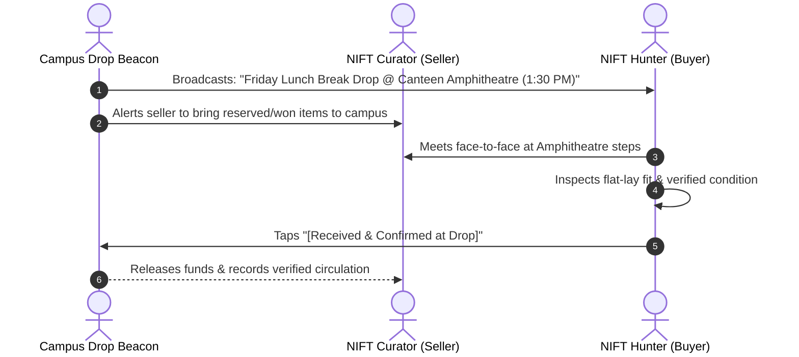

# NIFT HYDERABAD THRIFT CLOSET — Campus Circular Fashion & Live Bidding Architecture

> **Department of Fashion Communication, National Institute of Fashion Technology (NIFT), Hyderabad**  
> **Course:** Information Architecture & User Experience Design  
> **Student / Creative Director & Product Lead:** Simran Singh (`BD/24/164`)  
> **Technical Project Architect & UX Mentor:** Antigravity AI  

---

## 🏛️ Executive Summary & Hyperlocal Focus

**NIFT Hyderabad Thrift Closet** is a hyperlocal, peer-to-peer circular fashion platform designed exclusively for the **NIFT Hyderabad campus (Madhapur)**. It bridges the gap between design students' wardrobe turnover and sustainable fashion access by transforming informal Instagram stories and WhatsApp group clutter into a structured, transparent, and aesthetically elevated circular ritual.

### 🌟 Core Architectural Innovations:
1. **Bifurcated Condition Pricing Paradigms:**
   - **Tiers 1, 2 & 3 (`New / Unworn`, `Like New`, `Gently Used`):** **Direct Fixed Price Only.** No haggling, bidding, or lowballing. High-value garments sell at a fair, fixed curatorial price.
   - **Tiers 4 & 5 (`Well Used`, `Visible Wear / Flaws`):** **Campus Live Bidding.** Sellers set a base starting bid, and fellow students place competitive bids (+₹50, +₹100) leading up to the campus drop event!
2. **The "Campus Drop Event" Broadcast Beacon (Zero Courier Delivery):**
   - **Zero shipping, zero parcel packaging waste.** The app features an in-app **Event Beacon** announcing scheduled physical drop meets (e.g., *Friday Lunch Break Drop @ Canteen Amphitheatre & Lawn*). Buyers and sellers meet directly during studio/lunch breaks to inspect garments face-to-face and complete transactions immediately.
3. **Bilateral Campus Wardrobe Swap (`Item A ↔ Item B + Cash`):**
   - A structured peer barter engine where students can exchange pieces between departments with an optional cash balancer.
4. **Hyperlocal Departmental Proof-of-Concept:**
   - Focused strictly on NIFT Hyderabad (Fashion Communication, Fashion Design, Textile Design, Accessory Design, Knitwear Design) with plans to scale to other NIFT campuses once validated.

---

## 🧭 The 6-Phase Product Development Methodology

```
┌────────────────────────────────────────────────────────────────────────┐
│                      THE 6-STAGE GATE LIFECYCLE                         │
├────────────────────────────────────────────────────────────────────────┤
│  PHASE 1: Narrative & Objectives                                       │
│  └─ NIFT Campus Scope • Bifurcated Pricing • Zero-Courier Handoffs     │
│     [See PHASE1_NARRATIVE.md]                                          │
│                                                                        │
│  PHASE 2: Empathy & User Experience Modeling                           │
│  └─ Dual-Persona Spectrum (Curator & Hunter) • Empathy Map             │
│     [See PHASE2_EMPATHY_MODELING.md]                                   │
│                                                                        │
│  PHASE 3: Information Architecture & Taxonomy                          │
│  └─ 5-Tab Navigation • Dual-Mode Closet • 7-Layer PDP Blueprint        │
│     [See PHASE3_IA_TAXONOMY.md]                                        │
│                                                                        │
│  PHASE 4: User Flows & Low-Fidelity Wireframes                         │
│  └─ 6-Step Sell Wizard • Bidding Flow • Campus Drop State Machine      │
│     [See PHASE4_WIREFRAMES_FLOWS.md]                                   │
│                                                                        │
│  PHASE 5: Visual Design System & Tokens                                │
│  └─ Warm Ecru & Charcoal Canvas • Cobalt Accent • Event Beacon Styles  │
│     [See PHASE5_DESIGN_SYSTEM.md]                                      │
│                                                                        │
│  PHASE 6: Interactive Prototyping & Verification                       │
│  └─ Living Web Prototype • Bidding Modal • Break Drop Inspection       │
│     [Interactive Files: index.html • styles.css • app.js]              │
└────────────────────────────────────────────────────────────────────────┘
```

---

## 1. The Condition-Tier Pricing Paradigms

To protect garment value while allowing community market discovery for distressed pieces, the platform introduces a strict **Two-Track Commercial Model**:

```
5-TIER CONDITION RUBRIC & PRICING PARADIGMS
 ├── TRACK A: DIRECT FIXED PRICE (Tiers 1 – 3)
 │    ├── 1. New / Unworn  ──► Fixed Price Only (No bidding / No lowballs)
 │    ├── 2. Like New      ──► Fixed Price Only (Direct Buy or Swap)
 │    └── 3. Gently Used   ──► Fixed Price Only (Standardized transparent price)
 │
 └── TRACK B: CAMPUS LIVE BIDDING (Tiers 4 – 5)
      ├── 4. Well Used            ──► Starting Bid + Live Increments (+₹50, +₹100)
      └── 5. Visible Wear / Flaws ──► Upcycling Auction (Mandatory Flaw Photo)
```

### Why this matters for NIFT Students:
- **Designers & Curators (Sellers)** listing unworn or lightly used pieces don't get insulted by lowball DMs.
- **Upcyclers & Budget Thrifters** can bid on distressed, vintage, or well-loved items starting at pocket-friendly prices (e.g. ₹300–₹500) and upcycle them for styling projects.

---

## 2. Campus Drop Event Broadcast (Zero Shipping)

Unlike generic resale marketplaces that require domestic shipping partners, packaging materials, and delivery fees, NIFT Thrift Closet operates via **Scheduled Break Drops**:



### Campus Drop Zones:
1. **Canteen Amphitheatre & Lawn Steps:** The primary open-air social hub during lunch breaks (1:15 PM – 2:00 PM).
2. **Textile Department Lawn & Corridors:** Quiet outdoor lawn for studio break swaps.
3. **Resource Centre / Library Foyer:** Indoor neutral spot for detailed fitting and measurement validation.

---

## 3. Dynamic Category-Specific Flat-Lay Measurements

To eliminate sizing doubts across different brands and vintage cuts:
- **Tops:** Chest (Pit-to-pit), Shoulder width, Center back length, Sleeve length.
- **Bottoms:** Waist (flat across × 2), Hip, Inseam length, Rise.
- **Dresses:** Bust, Waist, Hip, Total length.
- **Outerwear:** Chest, Shoulder, Sleeve, Center back length.

---

## 4. The 7-Layer Product Detail Page (PDP)

Structured sequentially to answer:  
*What is it? → What condition is it in? → Will it fit? → Can I trust the seller? → How much is it? → Where do we meet on campus?*

1. **Hero Image Carousel** (Multi-angle studio photos + flaw macro)
2. **Item Identity & Paradigm Callout** (Fixed Price vs. Live Auction badge)
3. **True Flat-Lay Fit Specs** (Dynamic tabular specifications)
4. **Condition & Mandatory Flaw Transparency**
5. **Curatorial Attributes & Swap Wishlist**
6. **Seller Department Card** (e.g., *Ria Sharma • Fashion Comm (FC) '26*)
7. **Campus Drop Zone Location**
8. **Sticky Action Bar:**
   - *Fixed Price Items:* `[⇄ Propose Swap]` + `[Buy for ₹X (Fixed)]`
   - *Bidding Items:* `[⇄ Propose Swap]` + `[🔥 Place Bid (Min ₹Y)]`

---

## 🎨 Visual Design Tokens & Palette

- **Base Canvas:** Warm Soft Ecru (`#FBF9F5`) and Deep Charcoal (`#121214`).
- **Strategic Accent:** **Electric Cobalt Blue** (`#0F3BF7`).
- **Event Beacon Accent:** Deep Charcoal (`#121214`) with Signal Crimson indicator (`#FF3B30`).
- **Bidding Status Accent:** Warm Amber / Terracotta (`#FEF3C7` / `#B45309`).
- **Typography:** Contemporary Grotesque Sans (*Plus Jakarta Sans*) with monospaced tabular numerals (*Space Mono*).

---

## 🚀 Running the Interactive Prototype

The prototype is a self-contained, dependency-free web application.

### Direct Launch
Open [index.html](file:///c:/Users/Harshita%20Mehta/Documents/simran_BD_24_164/index.html) in Google Chrome, Microsoft Edge, or Safari.

---

## 📁 Repository File Structure

```
simran_BD_24_164/
├── instructions.md               # Operational role contract & stage gate rules
├── PHASE1_NARRATIVE.md           # Brand narrative, campus scope & pricing paradigms
├── PHASE2_EMPATHY_MODELING.md    # Dual personas, empathy maps & user journey maps
├── PHASE3_IA_TAXONOMY.md         # Navigation sitemap, category trees & PDP blueprint
├── PHASE4_WIREFRAMES_FLOWS.md    # 6-step sell wizard, bidding flows & drop state machine
├── PHASE5_DESIGN_SYSTEM.md       # Color tokens, typography scales & microcopy
├── index.html                    # Master interactive semantic HTML layout
├── styles.css                    # Design token stylesheet & campus drop layout
├── app.js                        # State machine, bidding engine & campus catalog
└── README.md                     # Comprehensive academic case study documentation
```

---

## 🎓 Academic Reflection

By localizing the circular economy directly to the NIFT Hyderabad campus, **Thrift Closet Resale** eliminates the packaging waste, shipping friction, and payment anxiety of traditional e-commerce. The bifurcated pricing paradigm protects garment dignity for premium pieces while opening distressed pieces to creative upcycling auctions—proving that sustainable fashion thrives best as a physical, community-grounded campus culture.
